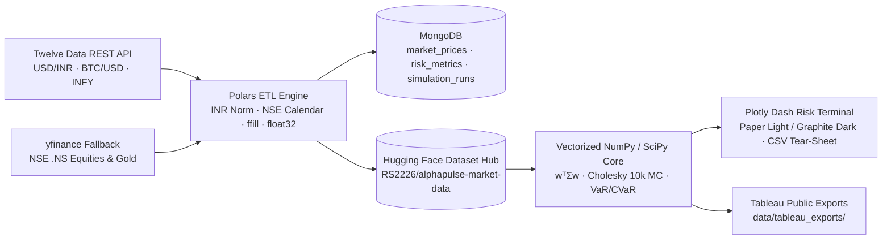

&lt;div align=&quot;center&quot;&gt;

# AlphaPulse — Financial Intelligence & Portfolio Risk Monitor

**Institutional market-risk engine, Euler risk-attribution framework, and macro stress-testing terminal for a multi-asset INR portfolio.**

[](https://www.python.org/)
[](https://dash.plotly.com/)
[](https://pola.rs/)
[](https://numpy.org/)
[](https://www.mongodb.com/)
[](https://huggingface.co/datasets/RS2226/alphapulse-market-data)
[](https://docs.astral.sh/ruff/)

[**Market Dataset (Hugging Face)**](https://huggingface.co/datasets/RS2226/alphapulse-market-data) · [**Source Repository**](https://github.com/Riddhis2226/AlphaPulse)

&lt;/div&gt;

---

## Investment Committee Mandate

Static return reports hide where capital is genuinely exposed during market drawdowns. **AlphaPulse** is a **Financial Intelligence & Risk Analytics** platform built to answer the four questions an institutional risk desk and portfolio committee evaluate daily across a diversified **7-asset INR mandate** (Indian NSE large-cap equities, sovereign-currency Gold ETF, and INR-normalized Bitcoin):

1. **Daily Downside Exposure:** What is the 1-day loss threshold at 95% and 99% confidence (**Historical & Parametric VaR**), and how severe are tail breaches (**Expected Shortfall / CVaR**)?
2. **True Risk Concentration:** Which holdings consume a disproportionate share of portfolio variance relative to their capital weight (**Euler Marginal Risk Attribution**)?
3. **Capital Adequacy Under Shock:** If a core sector sells off instantaneously, what is the immediate INR P&L impact and the **10,000-path forward wealth distribution**?
4. **Regime & Correlation Stability:** How do cross-asset correlations and 30-day rolling volatility regimes shift across 1-year, 2-year, and multi-year horizons?

---

## Executive Risk Memo & Headline Findings

*Audit Window: **850 overlapping NSE trading days** (`15 Jun 2023 – 25 Nov 2026`) · Base Currency: **INR (₹)** · Risk-Free Benchmark: **6.75%** (India T-Bill proxy).*

| Desk KPI | Verified Value | Financial Intelligence Readout |
| :--- | :---: | :--- |
| **1-Day 95% Historical VaR** | **1.28%** | Losses stay below 1.28% on 19 of 20 trading days; closely aligned with **Parametric Normal VaR (1.29%)**. |
| **1-Day 95% Expected Shortfall (CVaR)** | **1.86%** | Mean loss on the worst 5% of days (**1.45× VaR**), confirming heavier left-tail risk than VaR alone signals. |
| **Annualized Return / Volatility** | **7.79% / 12.73%** | Multi-asset INR return achieved across 6 distinct sector sleeves. |
| **Sharpe / Sortino / Calmar** | **0.08 / 0.12 / 0.35** | Excess return sits ~104 bps over the 6.75% risk-free rate; capital allocation efficiency is the primary lever. |
| **Maximum Drawdown** | **−22.41%** | Peak-to-trough portfolio loss monitored continuously on the underwater drawdown curve. |
| **Diversification Ratio** | **1.90×** | Cross-asset structure cuts volatility by **11.45 pts (−47%)**, from 24.18% weighted standalone to 12.73%. |
| **Primary Variance Driver** | **TCS (23.8% risk)** | Carries **18.0% capital weight** yet generates **23.8% of total portfolio variance** (`1.3×` risk-to-weight). |
| **Highest Risk-Adjusted Sleeve** | **SUNPHARMA (0.70)** | Delivers **+20.33%** annualized return on **19.26%** volatility (**1.04 Sortino**). |

### Strategic Portfolio Diagnosis (What the Numbers Say)
* **Diversification works, but capital allocation is misaligned:** Combining NSE equities, Gold (`GOLDBEES`), and `BTC_INR` slashes portfolio volatility nearly in half (`1.90×` diversification ratio), yet risk-adjusted excess return remains compressed (`0.08` Sharpe) due to negative drift in IT holdings. Rebalancing weights toward higher-Sharpe sleeves (`SUNPHARMA`, `GOLDBEES`) yields more impact than adding additional tickers.
* **Hidden IT Sector Concentration:** `TCS` (18%) and `INFY` (15%) represent **33.0% of invested capital** but drive **45.5% of total portfolio variance** (`23.8% + 21.7%`). Under the **−15% IT Sector Sell-Off** stress scenario on a **₹10.00 L** portfolio, immediate P&L is **−₹49,500 (−4.95%)**, leaving a **₹9.50 L** capital base with a **1-Year 95% Monte Carlo VaR of ₹1.16 L (12.22%)**.
* **Anchor Risk Limits on CVaR, Not VaR Alone:** With Expected Shortfall (`1.86%`) running **1.45×** Historical VaR (`1.28%`), desk loss limits and capital buffers should be calibrated to CVaR.

---

## Portfolio Construction & Euler Risk Attribution

*Verified full-window attribution across all 7 holdings (sorted by Euler Marginal Risk Share):*

| Instrument | Sector | Capital Weight | Risk Share | Beta | Ann. Return | Ann. Vol | Sharpe | Sortino | 1D 95% VaR |
| :--- | :--- | :---: | :---: | :---: | :---: | :---: | :---: | :---: | :---: |
| **TCS** | Technology | 18.0% | **23.8%** | 1.32 | −4.29% | 23.71% | −0.47 | −0.69 | 2.15% |
| **INFY** | Technology | 15.0% | **21.7%** | 1.45 | −0.44% | 26.48% | −0.27 | −0.39 | 2.54% |
| **RELIANCE** | Energy | 17.0% | **16.5%** | 0.97 | +5.03% | 21.64% | −0.08 | −0.12 | 2.04% |
| **HDFCBANK** | Financials | 18.0% | **16.3%** | 0.91 | +3.29% | 20.51% | −0.17 | −0.23 | 1.96% |
| **BTC_INR** | Crypto | 8.0% | **9.2%** | 1.16 | +28.48% | 46.19% | 0.47 | 0.73 | 4.31% |
| **SUNPHARMA** | Healthcare | 12.0% | **7.1%** | 0.59 | +20.33% | 19.26% | **0.70** | **1.04** | 1.95% |
| **GOLDBEES** | Commodities | 12.0% | **5.4%** | 0.45 | +20.51% | 21.36% | 0.64 | 0.73 | 1.66% |
| **Portfolio Total** | **6 Sectors** | **100.0%** | **100.0%** | **1.00** | **+7.79%** | **12.73%** | **0.08** | **0.12** | **1.28%** |

---

## Financial Intelligence Terminal (Plotly Dash)

Designed with dual **Paper (Light)** and **Graphite (Dark)** executive themes (`IBM Plex Sans` + tabular `IBM Plex Mono`), sticky global controls (**1Y / 2Y / Full History** lookback, **95% / 99% VaR confidence**), lakh/crore INR axis formatting, and **1-Click CSV Risk Tear-Sheet Export**:

| View | Decision Support Capabilities |
| :--- | :--- |
| **Overview** | Headline KPI strip (VaR, CVaR, Return/Vol, Sharpe/Sortino/Calmar), automated executive narrative, 3 risk-intelligence cards, **Cumulative Wealth & Underwater Drawdown**, **Capital Weight vs. Risk Share** bars, and the **Holdings Risk Attribution Matrix**. |
| **Stress Test** | Macro crisis presets (*IT Sell-Off −15%*, *Crypto Winter −40%*, *Energy Drawdown −20%*, *Gold Rally +15%*) or custom sector/shock sliders, memoized **10,000-Path Cholesky Monte Carlo** fan (`30D / 90D / 1Y`), terminal-wealth distribution with VaR & Median cutoffs, `P(Loss)`, and a **Holding-Level Shock P&L Waterfall**. |
| **Risk & Technicals** | Lower-triangle sector-grouped **Correlation Heatmap**, **Risk vs. Return Efficiency Map** with the Portfolio Sharpe line, **30-Day Rolling Volatility Regimes** (bold diversified portfolio line), and a **Single-Asset Tear-Sheet** (20D/50D MAs, volume, drawdown vs. 52W high). |

---

## Quantitative Methodology & Model Risk Governance

All metrics operate on daily log returns $r_t = \ln(P_t / P_{t-1})$ over split/dividend-adjusted, INR-normalized closes (`252` trading days/year):

| Quantitative Measure | Mathematical Definition |
| :--- | :--- |
| **Annualized Return & Volatility** | $\mu_{\text{ann}} = \bar{r}_p \times 252$, $\;\sigma_{\text{ann}} = \sqrt{w^\top \Sigma w} \times \sqrt{252}$ |
| **Sharpe / Sortino / Calmar** | $(\mu_{\text{ann}} - r_f)/\sigma_{\text{ann}}$, $\;(\mu_{\text{ann}} - r_f)/\sigma_{\text{down}}$, $\;\mu_{\text{ann}} / |\text{MaxDD}|$ ($r_f = 6.75\%$) |
| **Historical & Parametric VaR / CVaR** | Empirical $(1-c)$ quantile & conditional tail mean; Normal $\mu_p + z_{1-c}\sigma_p$ |
| **Euler Marginal Risk Share** | $RC_i = \dfrac{w_i (\Sigma w)_i}{w^\top \Sigma w}$ (exact additive variance decomposition) |
| **Diversification Ratio** | $DR = \dfrac{\sum_i w_i \sigma_i}{\sigma_p}$ |
| **Portfolio Beta** | $\beta_i = \dfrac{\operatorname{Cov}(r_i, r_p)}{\operatorname{Var}(r_p)}$ |
| **Cholesky Monte Carlo** | $R_{\text{sim}} = \mu + Z L^\top$ where $\Sigma = L L^\top$, vectorized across 10,000 paths × horizon |

### Model Risk Assumptions & Limitations
* **Single-Regime Sample:** 850 trading days (~3.4 years) limits tail density at 99% confidence (~8 tail observations), making 99% Historical VaR noisier than 95% VaR.
* **Gaussian Simulation Caveat:** Cholesky Monte Carlo assumes multivariate normality and constant covariance, which can understate crisis correlation spikes and fat tails—always pair with Historical CVaR.
* **Constant Weights & Embedded FX:** Assumes fixed weights with zero slippage, taxes, or transaction costs; `BTC_INR` embeds `USD/INR` FX volatility alongside Bitcoin price moves.
* **Calendar Alignment & Scope:** Forward-filling across NSE holidays can modestly dampen short-window volatility. Built strictly for financial analytics and portfolio risk education—not investment advice.

---

## Data Architecture & Engineering Stack



* **Data & ETL:** Python 3.11, `uv`, `polars`, `pyarrow`, `httpx`, `twelvedata`, `yfinance`, `pydantic-settings`
* **Quantitative Core:** `numpy` (zero-loop vectorized matrix math, `float32` downcasting), `scipy` (Cholesky, normal quantiles)
* **Persistence & BI:** **MongoDB Compass** (`pymongo`), **Hugging Face Hub** (`huggingface-hub`), Tableau flat CSVs (`data/tableau_exports/`)
* **Serving & Quality:** **Plotly Dash**, `dash-bootstrap-components`, `gunicorn` (**Render** / Docker), `ruff` (zero warnings), `pytest` (7 automated integrity & statistical sanity tests)

---

## Quick Start & Deployment

```powershell
git clone https://github.com/Riddhis2226/AlphaPulse.git
cd AlphaPulse
uv venv .venv --python 3.11
.\.venv\Scripts\Activate.ps1
uv sync
```

Copy `.env.example` to `.env` (never commit `.env`) with `TWELVE_DATA_API_KEY`, `MONGO_URI`, `HF_TOKEN`, and `HF_REPO_ID`, then run:

```powershell
uv run ruff check .
uv run python -m scripts.run_pipeline
uv run pytest -v
uv run python app.py
```

Open **`http://127.0.0.1:8050`**. *(Zero-setup dashboard mode: if `data/processed/market_prices.parquet` is absent locally, `app.py` fetches the cleaned Parquet dataset automatically from Hugging Face Hub.)*

```bash
# Production WSGI Start Command (Render / Docker)
gunicorn app:server --bind 0.0.0.0:${PORT:-8050} --workers 1 --threads 2 --timeout 120
```

---

## Repository Structure

```text
AlphaPulse/
├── app.py                              # Plotly Dash Financial Intelligence terminal
├── assets/custom.css                   # Paper (Light) & Graphite (Dark) design system
├── Dockerfile & requirements.txt       # Cloud container & Render runtime specification
├── pyproject.toml                      # uv dependency graph & Ruff lint rules
├── src/
│   ├── config.py                       # Typed Pydantic settings & 7-asset INR mandate
│   └── quant_engine.py                 # Vectorized VaR/CVaR, Sharpe, Monte Carlo & sync
├── scripts/
│   ├── week1_ingest.py                 # Twelve Data + yfinance ingestion & integrity checks
│   └── run_pipeline.py                 # End-to-end automated pipeline refresh
├── notebooks/
│   ├── week1_data_acquisition.ipynb    # Interactive ingestion & corporate-action audit
│   └── week2_quant_risk.ipynb          # Interactive Monte Carlo & volatility analysis
├── tests/
│   ├── test_week1_integrity.py         # Schema, float32, nulls & split continuity tests
│   └── test_week2_quant.py             # VaR/CVaR ordering & 10k simulation sanity tests
├── data/tableau_exports/               # Flat CSVs ready for Tableau Public
└── docs/AlphaPulse_Project_Report.pdf  # Infotact Executive Project Report (max 5 pages)
```

---

## Risk Desk Roadmap

* [ ] Benchmark against **NIFTY 50** for active alpha, tracking error, and information ratio
* [ ] Implement **VaR Backtesting** with exception counts and Kupiec POF test
* [ ] Add **Student-*t* / Filtered Historical Simulation** alongside normal Cholesky paths
* [ ] Build **Minimum-Variance & Risk-Parity Optimizer** comparing current vs. optimal weights
* [ ] Decompose **BTC_INR** variance into local crypto price risk vs. `USD/INR` FX risk
* [ ] Automate **GitHub Actions CI** running `ruff check` and `pytest` on every push

---

## Author

**Riddhima Singh** · [GitHub](https://github.com/Riddhis2226)  
*Built during the Infotact Solutions Enterprise Data Analytics Program (Q4 2025).*
